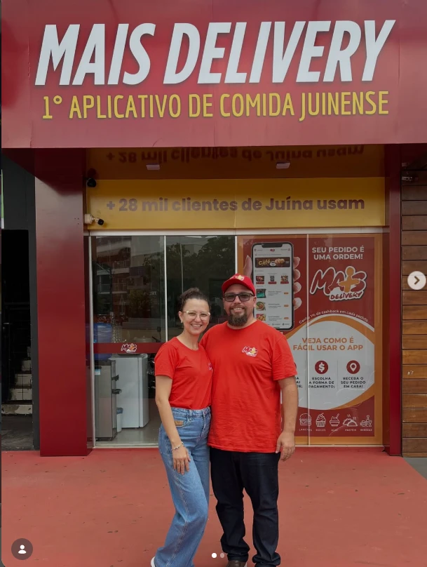

<div align="center">

# 🛵 Meu Funcionário — Mais Delivery

### Um funcionário de Inteligência Artificial que trabalha no painel do Mais Delivery por você.

**Grátis · Em português · Feito por quem opera uma franquia de verdade**

Criado por **Diego Simões**
[📸 @eudiegosimoes](https://instagram.com/eudiegosimoes) · [📸 @adm.delivery](https://instagram.com/adm.delivery) · [💬 WhatsApp (66) 99696-9693](https://wa.me/5566996969693)

⭐ **Se isso te ajudar, deixe uma estrela no repositório e me siga no Instagram!** ⭐



*Diego Simões na Mais Delivery Juína (MT) — o 1º aplicativo de comida juinense*

> 🙏 *"Consagre ao Senhor tudo o que você faz, e os seus planos serão bem-sucedidos."*
> — **Provérbios 16:3**

**Que Deus abençoe cada administrador e franqueado que usar esta ferramenta:
que ela traga mais tempo para a família, mais pedidos para as lojas,
mais trabalho para os motoboys e muita prosperidade para a sua cidade.** 🙌

</div>

---

## 📌 Índice
1. [O que é](#-o-que-é)
2. [Para quem é](#-para-quem-é)
3. [Tudo o que ele faz](#-tudo-o-que-ele-faz)
4. [Exemplos do que você pode pedir](#-exemplos-do-que-você-pode-pedir)
5. [Tutorial de instalação (passo a passo para leigos)](#-tutorial-de-instalação-passo-a-passo-para-leigos)
6. [Como usar no dia a dia](#-como-usar-no-dia-a-dia)
7. [Segurança: o que ele NUNCA faz](#-segurança-o-que-ele-nunca-faz)
8. [Armadilhas do painel que ele já conhece](#-armadilhas-do-painel-que-ele-já-conhece)
9. [Perguntas frequentes](#-perguntas-frequentes)
10. [O que tem dentro do repositório](#-o-que-tem-dentro-do-repositório)
11. [Aviso importante](#%EF%B8%8F-aviso-importante)
12. [Licença](#-licença)
13. [Sobre o autor e contato](#-sobre-o-autor-e-contato)

---

## 🤖 O que é

O **Meu Funcionário** é um *plugin* para o **Claude** (a inteligência artificial da Anthropic).
Depois de instalado, você conversa com o Claude em português — do jeito que falaria com um
funcionário — e ele **abre o painel do Mais Delivery no seu Chrome e faz o trabalho**:
cadastra loja, sobe cardápio com fotos, troca preço, cria pizza meio a meio, ajusta taxa de
bairro, libera motoboy, monta divulgação, gera relatório…

Ele não "adivinha" o painel: por trás existe um **mapa completo do painel do Mais Delivery**,
feito tela por tela, com **87 telas, 117 operações internas** e dezenas de regras descobertas
em testes reais (como o famoso bug da vírgula que transforma R$ 4,00 em R$ 400,00).

> Você continua no controle: ele **explica o que vai fazer, pede confirmação** antes de mexer
> em preço, dinheiro, pedido ou loja aberta, e **confere na tela** depois de gravar.

---

## 👥 Para quem é

- **Franqueados e administradores do Mais Delivery** que gastam horas no painel.
- Quem vai **inaugurar uma cidade** e precisa cadastrar dezenas de lojas e cardápios.
- Quem quer **padronizar** cardápios, taxas e divulgação sem depender de alguém técnico.
- Equipes de **implantação e suporte** de franquias de delivery.

Você **não precisa saber programar**. Precisa só conversar.

---

## 🧰 Tudo o que ele faz

### 🏪 Cadastro de lojas
- Cadastra **loja nova** a partir dos dados que você mandar (nome, endereço, WhatsApp, horário, logo, panfleto).
- Confere se a loja **já existe** (inclusive as que se cadastraram sozinhas e as redes nacionais).
- Preenche **endereço com coordenada**, segmentos, tempo de entrega, **horários de todos os dias** (até 3 turnos).
- Ajusta a **logo** para o tamanho certo (800×800).
- Liga o **integrador** da loja.
- Copia as **taxas de entrega** de uma loja vizinha parecida.
- Configura **formas de pagamento** e deixa a loja **Fechada** até o lojista começar.

### 🍔 Cardápio
- Monta o cardápio a partir de **foto, panfleto, PDF** ou de outras plataformas
  (**Anota AI, Saipos, MenuDino** e outras — com extratores prontos).
- **Confere o cardápio antes de subir** (preço errado, nome longo demais, produto sem preço, opções repetidas).
- Sobe **categorias e produtos** com descrição, preço e **fotos**.
- Cria **pizza meio a meio / "escolha X sabores"** com a regra de preço certa (média ou maior valor).
- Cria **açaí e lanches "monte o seu"** com adicionais ("escolha até 3").
- **Troca preços** de um ou de muitos produtos de uma vez.
- **Pausa e reativa** produtos (um ou vários).
- Corrige **produto que sumiu do app** (estoque zerado, horário do produto, inativo).
- Arruma a **ordem das categorias** e dos produtos.
- Configura os **"Sugeridos" ("peça também")** para aumentar o ticket médio (até 5 por produto).

### 🚚 Taxas de entrega e bairros
- Copia taxas de uma loja para outra.
- Aplica **taxa mínima** na cidade inteira, loja por loja.
- Inclui **bairro novo** nas lojas e remove bairro.
- Confere **frete grátis** e regras gerais da cidade.

### 🏍️ Motoboys (entregadores)
- Explica e prepara o **cadastro de motoboy** (externo, da cidade; ou interno, da loja).
- **Libera, coloca offline, inativa ou deixa em análise** o motoboy.
- Configura **filtros**: em quais lojas e bairros ele pode entregar e quais pagamentos não aceita.

### 📣 Divulgação
- Gera artes **"Parceiro Confirmado"**, stories e **feed com legendas otimizadas (SEO)**.
- Pega o **link e o QR Code** da loja para divulgar.
- Ajuda a montar **cupons** (porcentagem, valor ou frete grátis) e **promoções** do jeito que o painel aceita.
- Usa **carrinhos abandonados** e relatórios para ideias de remarketing.

### 📊 Auditoria e relatórios
- Gera os **relatórios do painel** (pedidos concluídos, cancelados, produtos mais vendidos, cupons,
  entregas por motoboy, tempo de entrega, clientes mais fiéis, produtos sem estoque e mais).
- Encontra **lojas fechadas há dias**, **produtos sem estoque**, problemas de **horário**, **pagamento** e **logo**.
- Lê o **Dashboard** da loja (vendas da semana, do mês, top produtos, top clientes).

### 🧾 Pedidos
- Mostra como **lançar pedido manual** e **mudar a situação** do pedido.
- **Cancelamento** com motivo (sempre com a sua confirmação — o cliente vê o motivo).
- Imprime o pedido em **PDF** (completo e cozinha).

### 🗺️ Mapa completo do painel
- [`MAPA-DO-PAINEL.md`](plugins/meufuncionario/docs/MAPA-DO-PAINEL.md): o painel explicado por menu,
  com receitas "pedido → caminho" e tudo que foi testado.
- [`ROTAS-DO-PAINEL.md`](plugins/meufuncionario/docs/ROTAS-DO-PAINEL.md): referência técnica de
  **87 telas e 117 operações**.
- [`PLAYBOOK-cadastro-lote.md`](plugins/meufuncionario/docs/PLAYBOOK-cadastro-lote.md): como preparar
  uma **cidade inteira** para inauguração.

---

## 💬 Exemplos do que você pode pedir

> "Chegou uma empresa nova, cadastra essa loja: [manda os dados e a logo]"

> "Sobe esse cardápio do panfleto" *(manda a foto)*

> "Pega o cardápio dessa loja no Anota AI e coloca no Mais Delivery"

> "Troca o preço do X-Bacon da Lanchonete do João para R$ 27,90"

> "Cria a pizza grande meio a meio com esses 12 sabores, cobrando pelo maior valor"

> "Coloca a mesma taxa de entrega da loja X na loja Y"

> "Coloca taxa mínima de R$ 7,00 em todas as lojas"

> "Libera o motoboy novo que se cadastrou"

> "Quais lojas estão fechadas há mais de 3 dias?"

> "Quais os 10 produtos mais vendidos do mês?"

> "Faz as artes de Parceiro Confirmado das lojas novas"

---

## 🛠️ Tutorial de instalação (passo a passo para leigos)

Leva uns 15 minutos. Você só faz uma vez.

### 🎬 [Assistir ao vídeo do tutorial (menos de 1 minuto, com narração)](assets/tutorial/tutorial-meu-funcionario.mp4)

### 👉 [Abrir o tutorial ilustrado, com uma imagem em cada passo](TUTORIAL.md)

[](TUTORIAL.md)

Resumo dos passos (os detalhes e as imagens estão no [tutorial](TUTORIAL.md)):

### ✅ Passo 1 — Tenha uma conta do Claude
Crie sua conta em [claude.ai](https://claude.ai). Para usar o Claude Code, é preciso um **plano pago
do Claude** (Pro ou Max). *Esse custo é da Anthropic; o Meu Funcionário é grátis.*

### ✅ Passo 2 — Instale o aplicativo do Claude no computador
Baixe em [claude.ai/download](https://claude.ai/download) e faça login com a sua conta.
Dentro do aplicativo, use a aba **Code** (é ela que roda os plugins no seu computador).

> ⚠️ Use o **aplicativo instalado no computador**. O Claude Code aberto pelo navegador
> (claude.ai/code) roda na nuvem e **não enxerga o seu Chrome**.

### ✅ Passo 3 — Instale a extensão "Claude in Chrome"
É ela que deixa o Claude mexer no painel **dentro do seu Chrome**, com o seu login.
Procure **"Claude in Chrome"** na Chrome Web Store, instale e faça login com a mesma conta do Claude.

### ✅ Passo 4 — Instale o Meu Funcionário
No aplicativo do Claude, aba **Code**, abra uma **nova sessão** e digite (um comando de cada vez):

```
/plugin marketplace add eudiegosimoes/maisdelivery-meufuncionario
```
```
/plugin install meufuncionario@maisdelivery-meufuncionario
```

Se aparecer uma pergunta para **confiar** no plugin, confirme.
Depois, **abra uma nova sessão** para ele carregar.

### ✅ Passo 5 — Entre no painel do Mais Delivery no Chrome
Abra o painel no seu Chrome e faça login **você mesmo** (o Claude nunca digita senha).
De preferência, entre como **gerencial da cidade**.

### ✅ Passo 6 — Peça!
Na sessão do Claude, escreva o que precisa. Exemplo:
> "Troca o preço do X-Bacon da Lanchonete do João para R$ 27,90"

Pronto. 🎉

### 🔄 Como atualizar
Quando sair versão nova, digite `/plugin` e atualize o **meufuncionario**
(ou remova e instale de novo com os comandos do Passo 4).

---

## 📅 Como usar no dia a dia

1. Deixe o **painel aberto e logado** no Chrome.
2. Peça **uma coisa por vez**, com os dados juntos (loja, produto, valor).
3. Quando ele perguntar **"Confirma?"**, leia o antes → depois e responda **sim** ou corrija.
4. Ele **confere na tela** e te mostra o resultado.
5. Para testar algo novo, use uma **loja de testes** antes da loja real.

---

## 🔒 Segurança: o que ele NUNCA faz

- ❌ Nunca digita **senha** nem **código de verificação** (quem digita é você).
- ❌ Nunca mostra nem guarda **links de login** das lojas.
- ❌ Nunca **abre loja, exclui, mexe em dinheiro, cancela pedido ou manda mensagem a clientes** sem o seu "sim".
- ❌ Nunca usa as operações perigosas do painel (por exemplo, a que **desativa todas as lojas da cidade**) sem ordem expressa.
- ✅ Trabalha **uma loja por vez**, com pausas, para não sobrecarregar o painel.
- ✅ Tudo acontece **no seu Chrome, com o seu login**. Nada é enviado para servidores do autor.

---

## 🧠 Armadilhas do painel que ele já conhece

Coisas que costumam dar errado quando se faz na mão — e que ele já sabe evitar:

| Armadilha | O que acontece | Como ele faz |
|---|---|---|
| Preço com **ponto** (4.00) | O painel grava **R$ 400,00** | Sempre usa **vírgula** (4,00) |
| Produto com **estoque 0** | Some do app ("indisponível") | Usa estoque **999999** (sem limite) |
| **Horário** no produto | O produto só vende naqueles dias | Deixa vazio, salvo pedido seu |
| Nível "por produto" com categoria preenchida | Vira nível da **categoria inteira** | Zera a categoria antes |
| Copiar produto | **Não copia os níveis** (sabores, adicionais) | Avisa e recria os níveis |
| Itens da promoção com ponto | Valor **×100** | Usa vírgula |
| Relatório com mais de 1 ano | Volta **vazio** sem avisar | Divide o período |
| Motoboy **inativo** | Some de **todas** as listas | Anota o ID antes |
| Editar motoboy | Pede **código no celular** do motoboy | Avisa antes |

---

## ❓ Perguntas frequentes

**É grátis mesmo?**
Sim, o Meu Funcionário é grátis. Você só precisa da sua assinatura do Claude (cobrada pela Anthropic).

**Funciona no celular?**
Não. Precisa do **computador** com o aplicativo do Claude e o Chrome.

**Ele pode estragar alguma coisa?**
Ele pede confirmação antes de qualquer ação importante e confere depois. Mesmo assim, é uma
ferramenta independente: **teste primeiro numa loja de testes** e acompanhe o que ele faz.

**Funciona em qualquer cidade do Mais Delivery?**
Sim — o painel é o mesmo para todas as franquias.

**Funciona no Windows e no Mac?**
Sim, onde o aplicativo do Claude e o Chrome funcionarem.

**O painel mudou e ele errou. E agora?**
Me avise pelo [WhatsApp](https://wa.me/5566996969693) ou abra uma *issue* aqui no GitHub.
O repositório tem uma ferramenta para remapear o painel.

---

## 📂 O que tem dentro do repositório

```
.claude-plugin/marketplace.json         "loja" de onde o plugin é instalado
plugins/meufuncionario/                 ⭐ o plugin (grátis)
  skills/
    cadastrar-loja/                     loja nova, integrador, horários, taxas
    cardapio/                           cardápio, fotos, níveis, preços, estoque, sugeridos
    taxas-bairros/                      taxas por bairro, bairro novo, taxa mínima
    motoboys/                           cadastro, status e filtros de entregadores
    divulgacao/                         artes, legendas, QR Code, cupons, promoções
    auditoria/                          relatórios, conferência da cidade
  docs/
    MAPA-DO-PAINEL.md                   o painel explicado + receitas + testes
    ROTAS-DO-PAINEL.md                  87 telas e 117 operações (referência técnica)
    PLAYBOOK-cadastro-lote.md           inauguração de cidade inteira
  ferramentas/
    painel-md/                          md-tools.js, rotas.json, ferramenta de varredura
    extratores/                         Anota AI, Saipos, MenuDino e outros
    artes/                              gerador de artes e feed
    sugeridos/                          "peça também" em lote
plugin-casca/ + servidor/               versão experimental com servidor de licença (para estudo)
docs/PLANO-DE-NEGOCIO.md                ideias de modelo de negócio
```

---

## ⚠️ Aviso importante

Este é um **projeto independente e não oficial**. **Não é afiliado, patrocinado nem aprovado**
pela franqueadora Mais Delivery. "Mais Delivery" é marca de seus respectivos donos e aparece aqui
só para dizer com qual painel a ferramenta trabalha.

Use por sua conta e risco, **sempre com o seu próprio login** e respeitando o contrato da sua
franquia. O painel pode mudar a qualquer momento, e o autor não se responsabiliza por alterações
feitas nas suas lojas.

---

## 📜 Licença

Distribuído sob a **Licença Apache 2.0** ([LICENSE](LICENSE)). Você pode usar, copiar e modificar,
inclusive para fins comerciais, **desde que mantenha o arquivo [NOTICE](NOTICE)** com a autoria de
**Diego Simões** e os contatos — inclusive em versões modificadas e redistribuídas.

Copyright © 2026 Diego Simões.

---

## 👋 Sobre o autor e contato

<div align="center">

### Diego Simões

Franqueado e administrador de delivery no interior do Mato Grosso, criando ferramentas
para quem vive o dia a dia do delivery.

[📸 Instagram @eudiegosimoes](https://instagram.com/eudiegosimoes) ·
[📸 Instagram @adm.delivery](https://instagram.com/adm.delivery) ·
[💬 WhatsApp (66) 99696-9693](https://wa.me/5566996969693)

**Quer implantar na sua cidade, tirar dúvidas ou sugerir melhorias? Me chama!**

> *"Tudo o que fizerem, façam de todo o coração, como para o Senhor."*
> — **Colossenses 3:23**

Fiz esta ferramenta de coração para servir quem trabalha com delivery.
Que ela seja uma bênção na sua franquia, como tem sido na nossa. 🙏

⭐ Deixe uma estrela · 🔁 Compartilhe com outros franqueados · 📸 Me siga no Instagram

</div>
