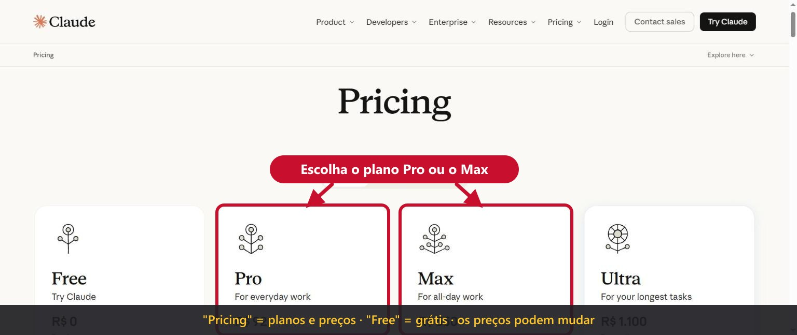
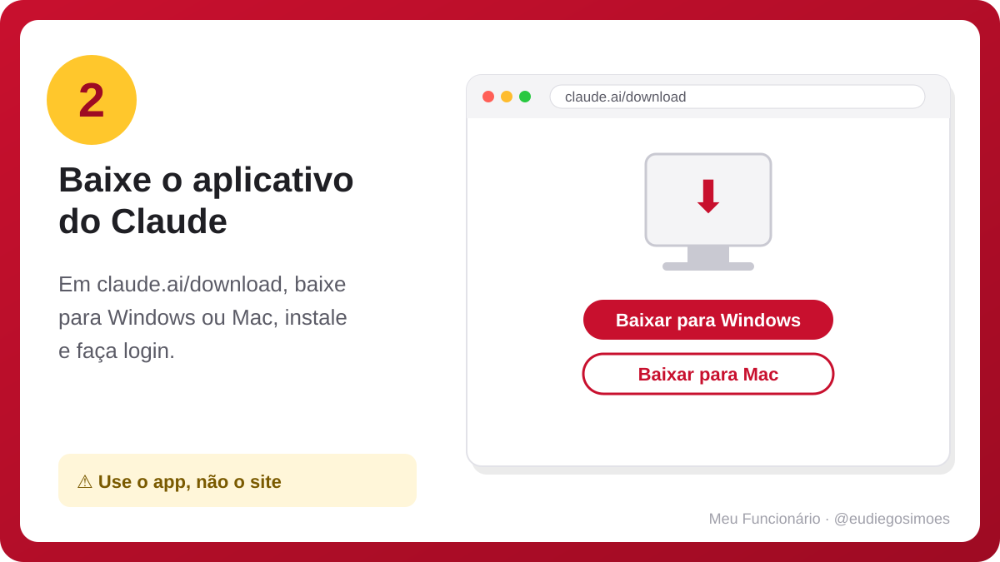
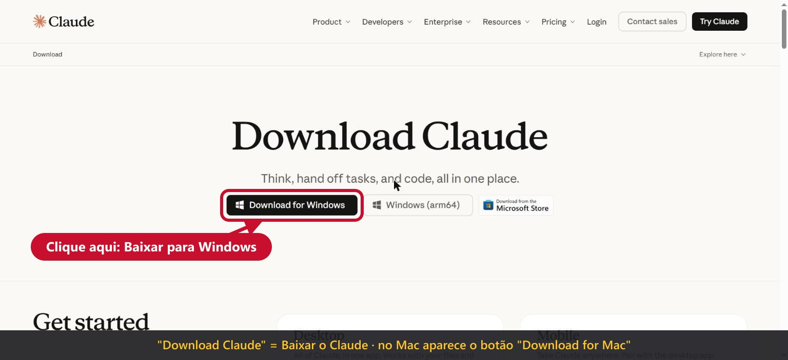
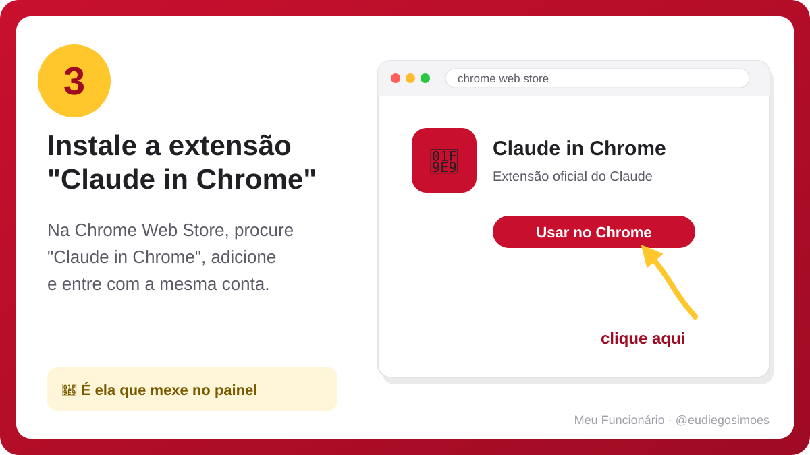
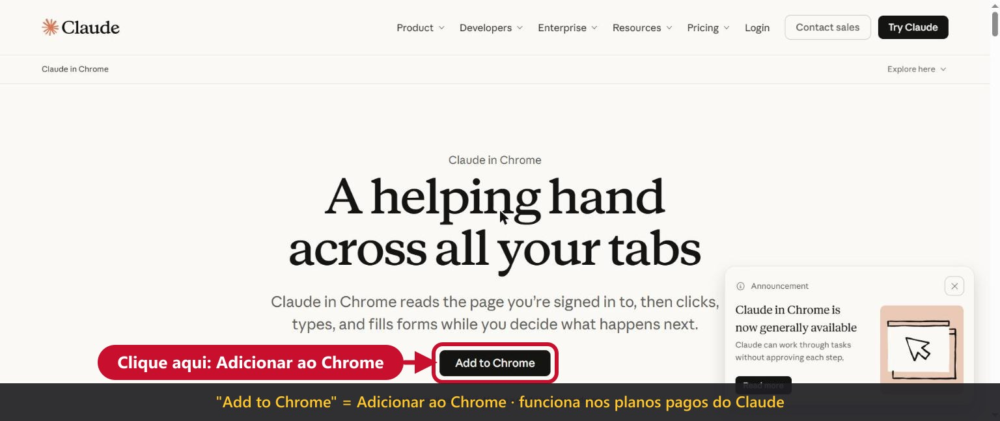
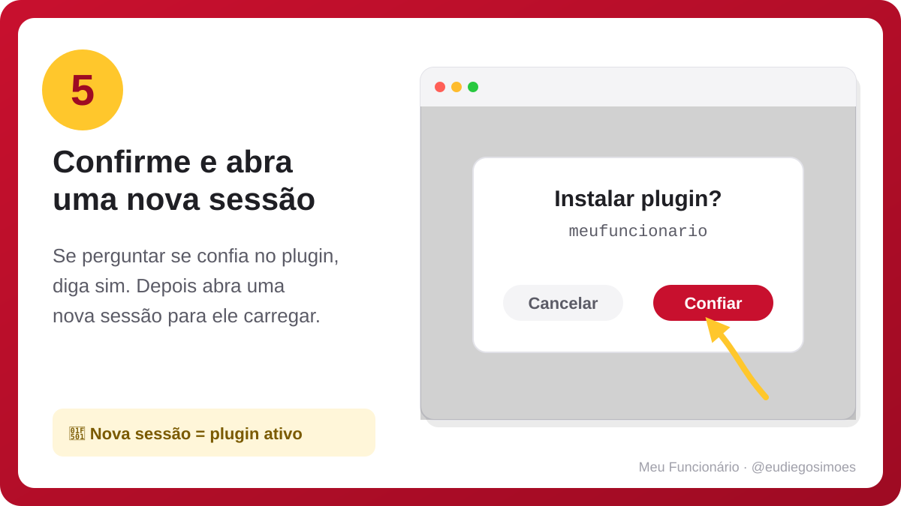
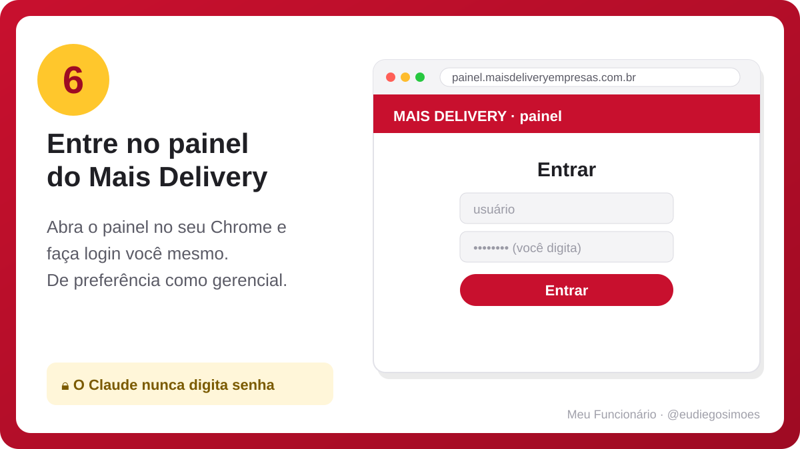
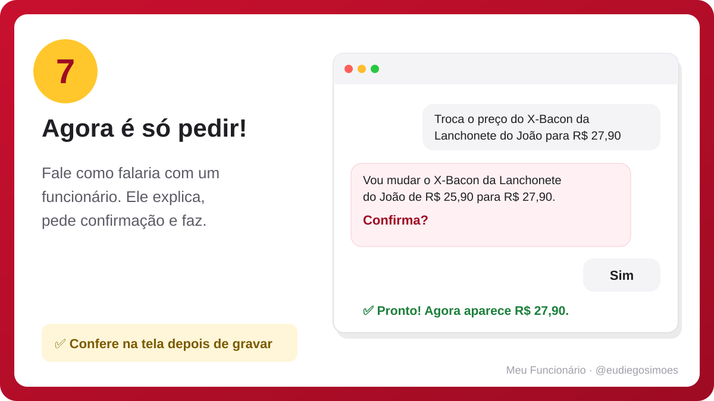
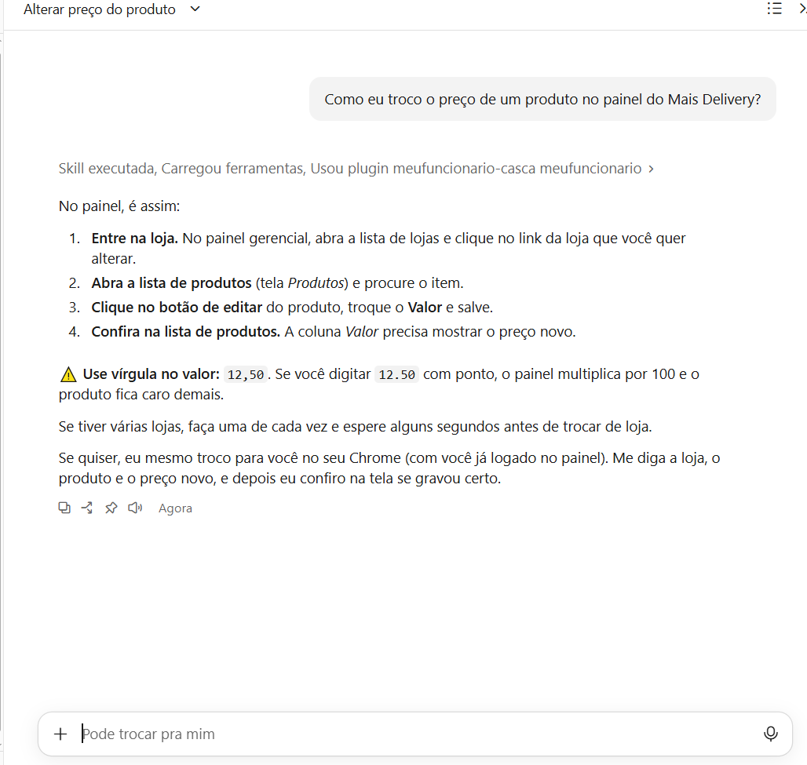

# 🛵 Como instalar o Meu Funcionário — passo a passo com imagens


### 🎬 Prefere assistir? [Clique aqui para ver o vídeo (menos de 1 minuto, com narração)](assets/tutorial/tutorial-meu-funcionario.mp4)

São **7 passos** e leva uns **15 minutos**. Você faz **uma vez só**.
Não precisa saber programar.

> Os cartões coloridos são **ilustrações** para te guiar. Onde aparece **📸 Tela de verdade**, é o print real do site.

---

## Passo 1 — Crie sua conta do Claude


**📸 Tela de verdade** (o site é em inglês; as marcações em vermelho mostram onde clicar) — os planos em [claude.com/pricing](https://claude.com/pricing). Escolha **Pro** ou **Max** (os preços podem mudar):



1. Abra **[claude.ai](https://claude.ai)** no navegador.
2. Faça o cadastro com o seu e-mail.
3. Escolha o plano **Pro** ou **Max** (é preciso um plano pago do Claude para usar o Claude Code).

💡 O **Meu Funcionário é grátis**. O que é pago é a assinatura do Claude, cobrada pela Anthropic.

---

## Passo 2 — Baixe o aplicativo do Claude



**📸 Tela de verdade** (o site é em inglês; as marcações em vermelho mostram onde clicar) — página de download. Clique em **Download for Windows** (no Mac aparece o botão do Mac):



1. Abra **[claude.ai/download](https://claude.ai/download)**.
2. Baixe a versão para o seu computador (**Windows** ou **Mac**) e instale.
3. Abra o aplicativo e entre com a sua conta.
4. Dentro dele, clique na aba **Code**.

⚠️ Tem que ser o **aplicativo instalado no computador**. O Claude aberto pelo site
(claude.ai/code) roda na nuvem e **não consegue mexer no seu Chrome**.

---

## Passo 3 — Instale a extensão "Claude in Chrome"



**📸 Tela de verdade** (o site é em inglês; as marcações em vermelho mostram onde clicar) — página da extensão em [claude.com/chrome](https://claude.com/chrome). Clique em **Add to Chrome**:



1. Abra o **Google Chrome**.
2. Entre na **Chrome Web Store** e procure **"Claude in Chrome"**.
3. Clique em **Usar no Chrome** (ou "Adicionar ao Chrome").
4. Entre com a **mesma conta** do Claude.

🧩 É essa extensão que deixa o Claude clicar e preencher o painel dentro do **seu** Chrome.

---

## Passo 4 — Instale o Meu Funcionário


1. No aplicativo do Claude, aba **Code**, clique em **nova sessão**.
2. Copie o **primeiro comando** abaixo, cole na caixa de mensagem e aperte **Enter**:

```
/plugin marketplace add eudiegosimoes/maisdelivery-meufuncionario
```

3. Agora copie o **segundo comando**, cole e aperte **Enter**:

```
/plugin install meufuncionario@maisdelivery-meufuncionario
```

📋 Dica: no GitHub, cada caixa de comando tem um botãozinho de **copiar** no canto direito.

---

## Passo 5 — Confirme e abra uma nova sessão



1. Se aparecer uma pergunta para **confiar** no plugin, confirme.
2. Depois, abra **outra nova sessão**. É nela que o Meu Funcionário já aparece carregado.

🔁 O plugin só "liga" em sessões abertas **depois** da instalação.

---

## Passo 6 — Entre no painel do Mais Delivery



1. No **Chrome**, abra o painel do Mais Delivery.
2. Faça o login **você mesmo**, com seu usuário e senha.
3. De preferência, entre como **gerencial da cidade**.
4. Deixe essa aba aberta.

🔒 O Claude **nunca digita senha**. Quem entra no painel é sempre você.

---

## Passo 7 — Agora é só pedir!



**📸 Tela de verdade** (o site é em inglês; as marcações em vermelho mostram onde clicar) — o Meu Funcionário respondendo:



Na sessão do Claude, escreva o que precisa, do jeito que falaria com um funcionário:

> "Troca o preço do X-Bacon da Lanchonete do João para R$ 27,90"

Ele vai:
1. **Dizer o que vai fazer**, com o antes e o depois.
2. **Perguntar "Confirma?"** — responda **sim** ou corrija.
3. **Fazer no painel** e **conferir na tela**.

---

## ✅ Ideias para começar

- "Cadastra essa loja nova: [dados + logo]"
- "Sobe esse cardápio do panfleto" *(mande a foto)*
- "Cria a pizza grande meio a meio com esses sabores"
- "Coloca taxa mínima de R$ 7,00 em todas as lojas"
- "Quais lojas estão fechadas há mais de 3 dias?"

## 🆘 Não deu certo?

| O que aconteceu | O que fazer |
|---|---|
| O Claude respondeu algo genérico, sem conhecer o painel | Abra uma **nova sessão**; se continuar, feche e abra o aplicativo |
| Ele diz que não consegue acessar o Chrome | Confira se a extensão **Claude in Chrome** está instalada e logada |
| Você está usando o Claude pelo site | Use o **aplicativo do computador** (Passo 2) |
| O painel pediu login de novo | Faça o login você mesmo e peça para ele continuar |

Ficou com dúvida? Me chama:
[📸 @eudiegosimoes](https://instagram.com/eudiegosimoes) ·
[📸 @adm.delivery](https://instagram.com/adm.delivery) ·
[💬 WhatsApp (66) 99696-9693](https://wa.me/5566996969693)

⬅️ [Voltar para a página principal](README.md)
